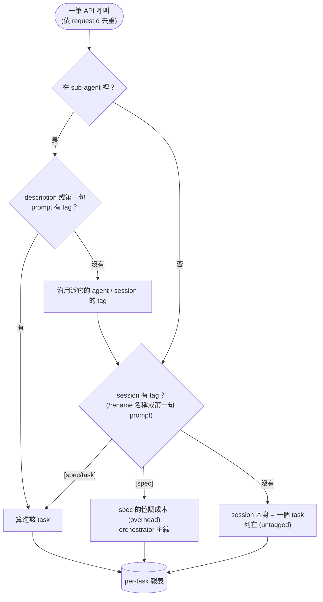

# claude-task-tokens

計算 Claude Code 中**每個 task 從頭到尾花了多少 token**：implement、review、修改都算在同一個 task 裡。

Claude Code 會自動把每次 API 呼叫的 token 用量寫進 `~/.claude/projects/` 下的 JSONL 對話紀錄。`task_tokens.py` 只讀這些紀錄，依 `[spec/task/階段]` tag 歸類後加總，不會呼叫任何 API，也不需要安裝套件（Python 3.9+ 標準函式庫）。

## 流程

```mermaid
flowchart LR
    subgraph S1["1. 標記"]
        A1["每個 task 一個 ID<br/>例如 [checkout/T3]"]
        A2["sub-agent description<br/>帶 tag"]
        A3["單一 prompt task<br/>= 一個 session"]
    end
    subgraph S2["2. 執行"]
        B1[implement agent]
        B2[review agent]
        B3[fix agent]
    end
    subgraph S3["3. Claude Code 自動紀錄"]
        C1["主 session .jsonl"]
        C2["subagents/agent-*.jsonl"]
        C3["agent-*.meta.json<br/>(含 description)"]
    end
    subgraph S4["4. task_tokens.py"]
        D1["依 requestId 去重"]
        D2["依 tag 歸類"]
        D3["加總 4 種 token"]
    end
    subgraph S5["5. 報表"]
        E1["每個 task：<br/>input / cache / output"]
        E2["換算成 USD"]
    end
    S1 --> S2 --> S3 --> S4 --> S5
```



## 歸屬規則：誰帶 tag，token 就算誰的



- 同一個 tag 可以分散在好幾個 session 裡，腳本會自動合併。所以一個 orchestrator 派工（做法 B）和另開 session 補修（做法 A）可以混著用。
- 協調成本可以分開列，也可以用 `--allocate-overhead` 依各 task 的花費比例分攤。

## Tag 格式

```
[spec名稱/task-id/階段]   ← 只能放在文字最開頭
```

- **spec 名稱**：必填，例如 `checkout`
- **task-id**：選填，例如 `T3`
- **階段**：選填，例如 `impl`、`review`、`fix`。加上 `--by-phase` 可以拆開看
- 每段只能用英數字、`-`、`_`、`.`，段與段之間用 `/` 隔開
- 英文大小寫視為相同（`T3` = `t3`）
- 括號用半形 `[ ]`，全形 `［ ］` 也認得

| 寫法 | 腳本認成 |
|---|---|
| `[checkout] 依 spec.md 派工` | checkout 的協調成本 |
| `[checkout/T3] implement 付款 API` | checkout → T3 |
| `[checkout/T3/review] 檢查 T3` | checkout → T3（review 階段） |
| `[checkout/T3/fix] 修 review 意見` | checkout → T3（fix 階段） |
| `實作 [checkout/T3]` | ❌ 不認：不在開頭 |
| `[checkout T3]` | ❌ 不認：中間要用 `/` |
| `[結帳/T3]` | ❌ 不認：不能用中文 |
| `[docs](https://…)` | ❌ 不認：Markdown 連結 |

**腳本去哪裡找 tag（依優先順序）**

1. sub-agent 的 description（派工時寫的那一行），沒有的話看它收到的第一句 prompt
2. sub-agent 沒有 tag：沿用派它的 agent 或 session 的 tag
3. session 名稱（`/rename`）
4. session 的第一句 prompt

三個地方都找不到 tag 的話，那個 session 就自己算一個 task。

## 使用方式

```bash
python3 task_tokens.py                          # 全部 session
python3 task_tokens.py --tag checkout           # 只看一份 spec
python3 task_tokens.py --tag checkout/T3 --by-phase   # 一個 task，拆成各階段
python3 task_tokens.py --tagged-only --allocate-overhead
python3 task_tokens.py --project my-site --since 2026-11-01
python3 task_tokens.py --format csv > usage.csv # 或 --format json
```

| 參數 | 說明 |
|---|---|
| `--tag` | 只看某個 spec 或 task，例如 `checkout`、`checkout/T3` |
| `--by-phase` | 把每個 task 拆成 impl / review / fix 等階段 |
| `--allocate-overhead` | 把 spec 的協調成本依各 task 的花費比例分攤 |
| `--tagged-only` | 隱藏沒有 tag 的 session |
| `--project` | 只看專案資料夾名稱或 cwd 含有這段文字的 session |
| `--since` / `--until` | UTC 時間範圍（含 since，不含 until） |
| `--format` | `table`（預設）、`csv`、`json` |
| `--projects-dir` | 紀錄資料夾，預設 `~/.claude/projects`（會讀取 `CLAUDE_CONFIG_DIR`） |

輸出範例：

```
spec            task                  reqs   input  cache_w  cache_r  output   total  cost_usd
checkout        (overhead)               2     150        0        0      15     165      0.00
checkout        t3                       4   1,900      500    2,000     290   4,690      0.02
checkout        t4                       1     700        0        0      70     770      0.00
                = checkout subtotal      7   2,750      500    2,000     375   5,625      0.02
(untagged)      33333333 Change homepage title  1  80     0        0       8      88      0.00
```

## 讓 Claude 自動帶 tag

把 [`claude-md-snippet.md`](claude-md-snippet.md) 的內容貼進專案的 `CLAUDE.md`，orchestrator 派工時就會自動加上 tag。

## 注意事項

- **去重**：同一次 API 呼叫在紀錄裡會被拆成好幾行，每行都帶同一份 usage。腳本依 `requestId` 只算一次；resume 或 fork 出來的 session 重複出現的請求也只算一次。
- **四種 token 要分開看**：cache read 的單價大約只有一般 input 的 1/10 到 1/40，比較 task 時看 `cost_usd` 比看 `total` 準。
- **價格**：內建 2026-11-03 的 API 定價（`PRICES` 表，cache 寫入 5 分鐘為 input 的 1.25 倍、1 小時為 2 倍；fast mode 為 2 倍）。表裡沒有的模型只算 token，不算金額，會在報表標 `*`。Pro / Max 方案不按 token 計費，`cost_usd` 請當作「換算成 API 的等值金額」。
- **紀錄保留期限**：Claude Code 預設只保留約 30 天的紀錄。想長期追蹤，請在 `~/.claude/settings.json` 調大 `cleanupPeriodDays`，或定期把 `--format csv` 的結果另存。
- **範圍**：只涵蓋這台電腦上的 Claude Code，不包含 claude.ai 網頁版或其他電腦上的對話。
- tag 只對加上 tag 之後的工作有效；舊紀錄會以 session 為單位列在 `(untagged)`。

## 測試

```bash
python3 -m unittest discover -s tests -v
```
